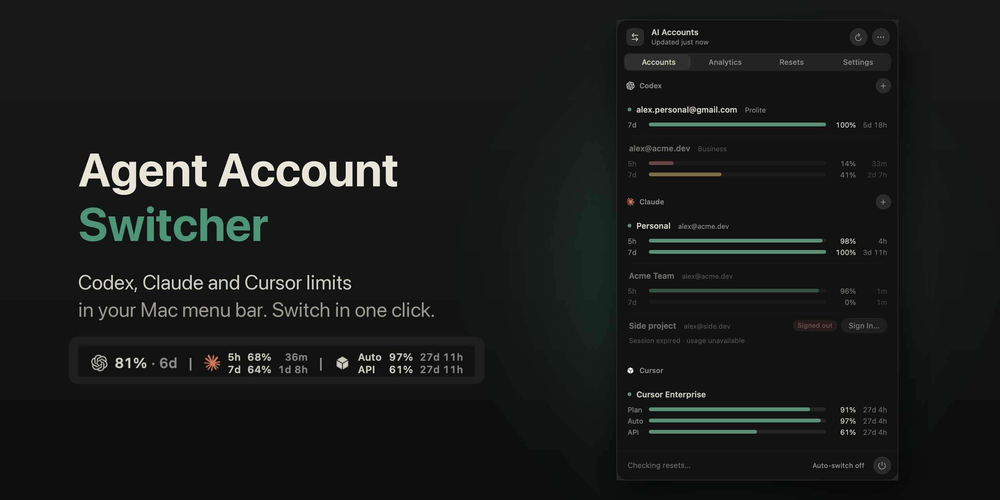
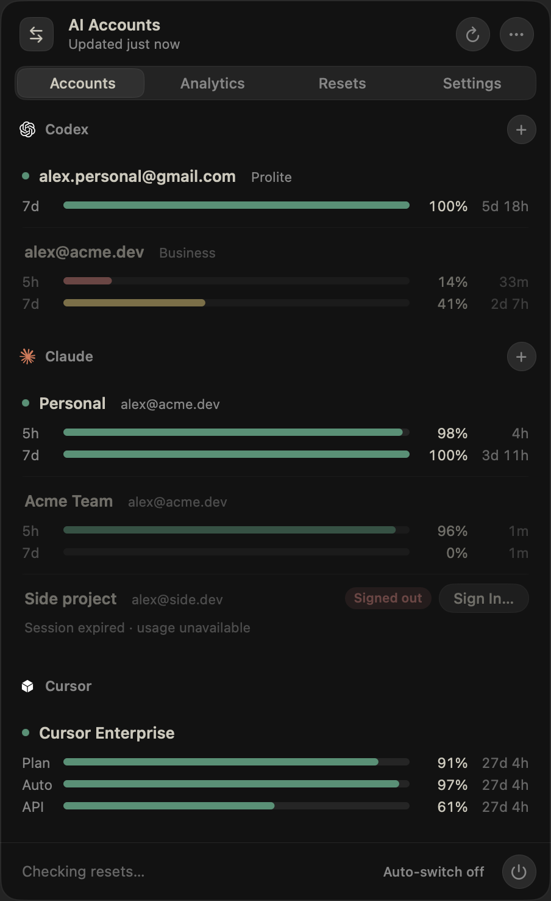
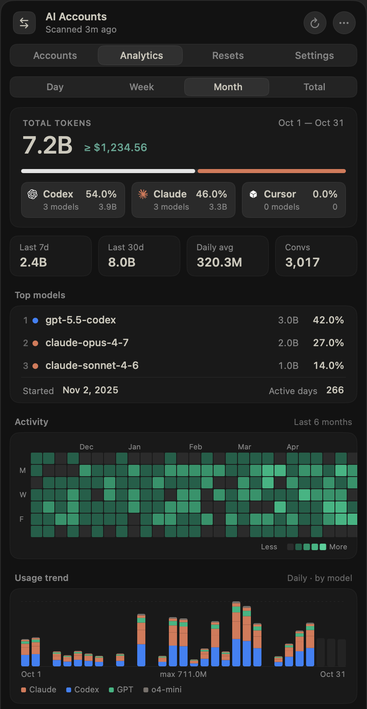
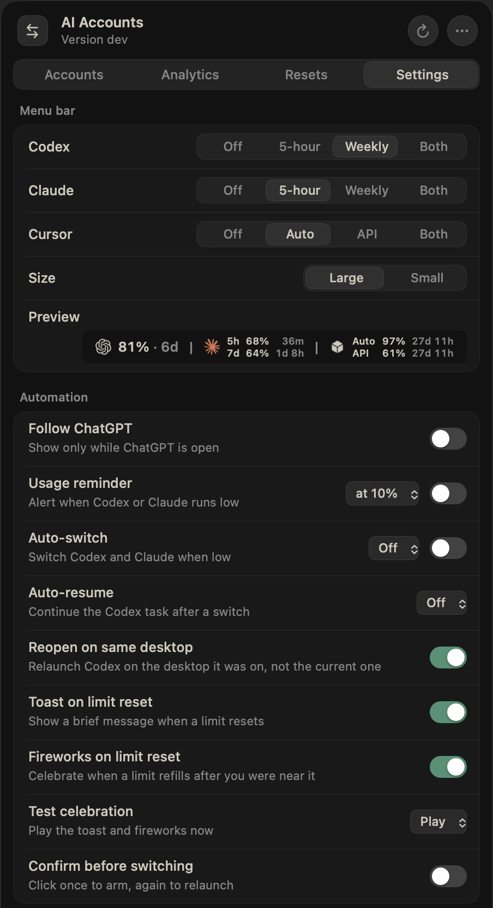

<p align="center">
  
</p>

<h1 align="center">Agent Account Switcher</h1>

<p align="center">
  Codex, Claude Code and Cursor limits in one Mac menu bar app.<br>
  See what’s left on every account and switch Codex or Claude accounts in one click.
</p>

<p align="center">
  <a href="#build-from-source"><strong>Build from source</strong></a>
  &nbsp;·&nbsp;
  <a href="https://github.com/lordydord/Codex-Account-Switcher">Upstream project</a>
  &nbsp;·&nbsp;
  <a href="CHANGELOG.md">What’s new</a>
</p>

<p align="center">
  
  
  
  
</p>

---

## What it does

If you use Codex with more than one ChatGPT account, you know the routine: a limit runs out mid-task, you sign out, sign in to another account, and hope it has room. Codex Account Switcher takes care of that from the menu bar.

- **See every limit at once.** The 5-hour and weekly limits for each saved account, updated live.
- **Switch in one click.** It saves your session, changes account, checks the change worked, then reopens ChatGPT. If anything goes wrong, it puts the previous account back.
- **Know which account to use next.** The account with the most room left is marked “Best next”.
- **Use reset credits before they expire.** Every credit across your accounts, soonest first, with a confirmation before any is spent.
- **Let it run itself.** Optional auto-switch when a limit gets low, auto-resume to carry on the task, and usage reminders.

<table>
  <tr>
    <td width="33%" valign="top"></td>
    <td width="33%" valign="top"></td>
    <td width="33%" valign="top"></td>
  </tr>
  <tr>
    <td align="center"><sub>Accounts</sub></td>
    <td align="center"><sub>Analytics</sub></td>
    <td align="center"><sub>Settings</sub></td>
  </tr>
</table>

## New in 3.0

A ground-up redesign for macOS 27, and a much lighter app underneath.

- **Liquid Glass throughout.** One glass panel with a standard toolbar and tabs, in light and dark.
- **Limits you can read at a glance.** Rings for the active account, slim meters for the rest.
- **A calmer menu bar item.** A small usage ring that only turns red when you’re nearly out.
- **Faster.** Switches finish seconds sooner, the panel opens instantly, and the app does far less in the background.

Read the [full release notes](docs/release-notes/v3.0.md).

## Claude accounts (fork addition: AI Account Switcher)

The **Accounts** tab lists Codex and Claude Code subscription logins in separate sections; Settings, the usage reminder and auto-switch cover both.

- Each saved login shows its 5-hour and 7-day limits as bars; the menu bar shows `[OpenAI] % | [Claude] %` with each logo.
- **Switch** swaps the `Claude Code-credentials` Keychain item and `oauthAccount` in `~/.claude.json`, keeping other keys such as MCP OAuth tokens. New Claude Code sessions use the new account.
- The token owner is checked with Anthropic before a login is saved, so a stale `~/.claude.json` cannot mix accounts.
- **Add Claude Account** opens Terminal with `claude auth login`; the new login is saved automatically. Inactive logins refresh their own tokens.
- Profiles from the earlier Python `claude-switcher` are imported on first launch.

## Analytics tab (fork addition)

Token usage from the local Codex and Claude Code logs (`~/.codex/sessions`, `~/.codex/archived_sessions`, `~/.claude/projects`), ported from [TokenTracker](https://github.com/xiufengsun/TokenTracker) (MIT):
total tokens and estimated USD cost per day, week, month or the last 24 months, a 52-week heatmap, a usage trend by model, top models, a daily and per-project breakdown, and session efficiency (edit sessions, first-pass rate, cost per edit).

- Logs are only read. The index lives in `~/Library/Application Support/AI Account Switcher/analytics/`; the first build reads every log (about 100 s for 14 GB), later refreshes read only new bytes.
- Compressed Codex rollouts (`.jsonl.zst`) are decoded by a built-in zstd decoder.
- Prices come from `Resources/analytics-pricing.json` (TokenTracker's curated and LiteLLM prices for GPT, Codex, o-series and Claude). A "≥" marks totals that include an unpriced model.

## Install

1. [Build from source](#build-from-source), or download an upstream build from [Releases](https://github.com/lordydord/Codex-Account-Switcher/releases/latest) (Codex only), and move **AI Account Switcher** to Applications.
2. The app isn’t notarised yet, so the first time, right-click it and choose **Open**.
3. Install [codex-auth](https://www.npmjs.com/package/@loongphy/codex-auth) and sign in once for each ChatGPT account:

   ```bash
   npm install -g @loongphy/codex-auth
   codex-auth login
   ```

**You’ll need:** macOS 14 or later (designed for macOS 27), the ChatGPT desktop app in Applications, and codex-auth.

Each release includes a SHA-256 checksum so you can check the download.

## How switching works

Every switch follows the same routine:

1. Save the current session, so nothing is lost.
2. Ask codex-auth to change account, then confirm the new account really is active.
3. If it isn’t, restore the previous account and explain what happened.
4. Quit and reopen ChatGPT on the new account.

Auto-switch waits a short cooldown between switches, so it never bounces back and forth.

Reset credits work the same careful way: using one always asks first. The app never retries a spend on its own, and only reports success once ChatGPT confirms the limit was reset.

## Privacy

- The app uses the sign-ins codex-auth already keeps on your Mac. It adds no telemetry, no adverts and no extra account.
- Your sign-ins are only used to talk to ChatGPT, to check your limits and reset credits.
- This repository contains no credentials, tokens, account IDs or real email addresses. Every screenshot uses demo accounts.
- **Diagnostics** in the ••• menu copies a health report you can share, without tokens or account IDs.

## Build from source

You’ll need the Xcode command line tools.

```bash
git clone https://github.com/anhdd-kuro/agent-account-switcher.git
cd agent-account-switcher
./run-tests.sh      # infrastructure and reset-logic checks
./build.sh          # builds build/AI Account Switcher.app
./install.sh        # copies it to /Applications
```

`./package-release.sh` creates a verified release zip and checksum.

<details>
<summary>Project layout</summary>

```text
Sources/main.swift               App delegate, account workflows, switching and resets
Sources/AccountPanelView.swift   The menu bar panel: Accounts, Resets, Settings
Sources/PanelComponents.swift    Liquid Glass controls, rings, meters and menu bar glyphs
Sources/Models.swift             Shared models and the panel theme
Sources/AppInfrastructure.swift  Commands, networking and shared policies
Sources/LifecycleMonitor.swift   Opens and closes the switcher alongside ChatGPT
Tests/                           Infrastructure checks
docs/                            The website (GitHub Pages)
```

</details>

## Licence

MIT. See [LICENSE](LICENSE). The Analytics engine and pricing data are adapted from [TokenTracker](https://github.com/xiufengsun/TokenTracker), MIT.

Codex Account Switcher is an independent open-source project. It isn’t affiliated with or endorsed by OpenAI.
